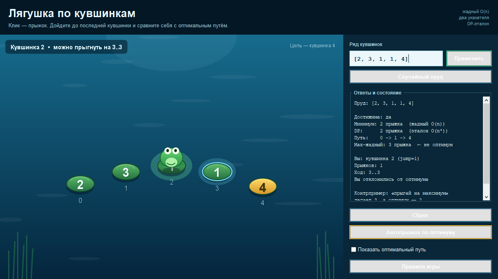

# «Лягушка по кувшинкам» — 1D-прыжки, жадный алгоритм, два указателя и DP

## 1. Какую задачу решает проект

Есть ряд кувшинок. На каждой кувшинке `i` написано целое неотрицательное число
`jump[i]` — насколько далеко с неё можно прыгнуть вперёд. Лягушка стартует на
кувшинке `0` и хочет попасть на последнюю кувшинку `n - 1`.

Из кувшинки `i` разрешён прыжок на любую кувшинку `j`, для которой
`i < j <= i + jump[i]` (если `i + jump[i]` больше конца ряда, достаточно
добраться до последней кувшинки).

Программа отвечает на два вопроса:

1. **Достижима ли последняя кувшинка?** — жадный алгоритм, `O(n)` времени,
   `O(1)` памяти.
2. **За сколько минимально прыжков можно добраться?** — жадный алгоритм с
   двумя указателями `currentEnd`/`farthest`, `O(n)` времени, `O(1)` памяти.

Основной интерфейс — **Swing-игра**: лягушка прыгает по клику, кувшинки
подсвечиваются, прыжок анимируется, а справа в реальном времени видно ответ
жадного алгоритма, DP-эталон, оптимальный путь и результат стратегии
«прыгай на максимум». Консольный режим сохранён для защиты, тестов и сред без
графического интерфейса.

Дополнительно реализован **наивный DP** `O(n^2)` — как эталон корректности для
тестов и как восстановление оптимального пути. А стратегия «прыгай каждый раз
на максимально далёкую кувшинку» оставлена в проекте специально как
**контрпример**: она не оптимальна, и это видно на массиве
`[2, 3, 1, 1, 4]`.

### Почему это не «просто ещё одна задача»

В проекте явно видны три разные техники курса:

| Вопрос / компонент | Техника | Сложность |
|---|---|---|
| Достижима ли цель | жадный алгоритм, одна переменная `farthest` | `O(n)` время, `O(1)` память |
| Минимум прыжков | два указателя / скользящее окно `currentEnd` + `farthest` | `O(n)` время, `O(1)` память |
| Проверка корректности и путь | динамическое программирование по индексам | `O(n^2)` время, `O(n)` память |
| Контрпример | жадный алгоритм «по длине прыжка» | `O(n)` время, `O(n)` память на путь |
| Ввод | парсер и валидация | `O(n)` |

Рекурсия не используется: все алгоритмы итеративные, поэтому глубина стека не
зависит от `n`, и переполнение стека невозможно.

---

## 2. Структура проекта

```text
src/main/java/com/example/
  Main.java                       — точка входа: Swing-игра или консольный режим
  model/
    Pond.java                     — неизменяемый пруд: массив прыжков + имя, валидация
    JumpArray.java                — единая проверка «сырого» int[] (null, пусто, отрицательные)
    JumpPath.java                 — путь лягушки (индексы строго вперёд)
    MaxJumpAttempt.java           — результат стратегии «прыгай на максимум»
    GreedyStep.java               — один шаг трассировки двух указателей
    PondAnalysis.java             — согласованный отчёт по одному пруду
  solver/
    FrogJumper.java               — canReach, minJumps, minJumpsDp, optimalPath
    MaxJumpGreedy.java            — наивная стратегия «самый далёкий прыжок» (контрпример)
    FrogAnalyzer.java             — запускает все алгоритмы и проверяет инварианты
  game/
    GameSession.java              — правила партии: текущая кувшинка, ходы, победа
    RandomPondFactory.java        — корректные случайные пруды для игры
  io/
    PondParser.java               — разбор строки/файла, комментарии, ошибки с позицией
  ui/
    FrogGameFrame.java            — главное окно Swing-игры и панель отчёта
    PondCanvas.java               — отрисовка пруда, лягушки и анимации прыжка
    GameIcon.java                 — иконка приложения, нарисованная кодом
    Renderer.java                 — ASCII-визуализация пруда, ответов и трассировки
    ConsoleDemo.java              — сценарии демонстрации на защите
  bench/
    BenchmarkRunner.java          — сравнение времени жадного `O(n)` и DP `O(n^2)`
src/test/java/com/example/         — 64 теста JUnit 5
data/pond.txt                      — пример входного файла (тот самый контрпример)
docs/game.png                      — скриншот Swing-игры для README
```

Разделение сделано по смысловым областям, а не «всё в одном Main»:

* `model` не знает ни о вводе-выводе, ни об алгоритмах;
* `solver` не знает, откуда пришёл массив;
* `game` содержит только правила партии и не зависит от Swing;
* `Renderer` и `PondCanvas` не содержат алгоритмов — только оформляют готовые данные;
* `Main` и `ConsoleDemo` не содержат логики решения.

---

## 3. Как запустить

Нужны JDK 17+ и Maven 3.9+.

```bash
mvn test                 # 64 теста
mvn package              # собрать target/frog-jumper.jar

java -jar target/frog-jumper.jar                # Swing-игра
java -jar target/frog-jumper.jar --console      # полная консольная демонстрация
java -jar target/frog-jumper.jar --pond "2,3,1,1,4"
java -jar target/frog-jumper.jar --file data/pond.txt
java -jar target/frog-jumper.jar --bench 8000
java -jar target/frog-jumper.jar --help
```

Без аргументов открывается игра. В headless-среде (без графического
интерфейса) автоматически запускается консольная демонстрация. Явный режим
`--game` требует графическую среду, `--console` всегда работает в терминале.

### 3.1 Как играть



* На каждой кувшинке написано число — максимальная длина прыжка с неё.
* Подсвеченные голубым кувшинки доступны из текущей позиции. Клик по ним
  запускает анимацию прыжка; клик слишком далеко подсвечивает ошибку.
* Цель — последняя кувшинка. Справа показаны текущая позиция, число прыжков,
  ответ жадного `O(n)`, проверка DP и оптимальный путь.
* **«Сброс»** возвращает на старт, **«Автопрыжок по оптимуму»** проходит путь
  `0 -> ... -> n-1` автоматически, **«Показать оптимальный путь»** рисует его
  пунктиром.
* Поле ввода принимает тот же формат, что и консоль: `2,3,1,1,4`,
  `[2 3 1 1 4]`, числа через `;`. Для читаемости на экране игра ограничена
  20 кувшинками; для больших `n` используйте `--console` и `--bench`.
* **«Случайный пруд»** создаёт достижимый пруд с нулями и несколькими
  вариантами пути — удобно проверять, что жадный не путает локальный максимум
  с оптимумом.

### 3.2 Консольный режим

`--console` (он же старый `--demo`) запускает полную демонстрацию: основной
сценарий, контрпример, недостижимый пруд, пограничные случаи, ошибки ввода и
сводную таблицу. `--pond` и `--file` разбирают один пруд и дополнительно
показывают трассировку двух указателей.

Если в Windows-консоли русский текст отображается «кракозябрами», запустите
консольный режим с явной кодировкой вывода:

```bash
java -Dstdout.encoding=UTF-8 -Dstderr.encoding=UTF-8 -jar target/frog-jumper.jar --console
```

Можно обойтись без сборки jar:

```bash
mvn compile
java -cp target/classes com.example.Main            # игра
java -cp target/classes com.example.Main --console  # консоль
```

Формат файла: числа через запятую, пробел или `;`; допустимы квадратные скобки;
комментарии начинаются с `#` до конца строки. Пустой файл, нечисловой токен и
отрицательный прыжок отклоняются с понятным сообщением.

`--pond` и `--file` всегда запускают ещё и DP-эталон с восстановлением пути,
поэтому рассчитаны на небольшие демонстрационные пруды. Для больших `n`
используйте `--bench`: там на миллионе кувшинок запускается только жадный
`O(n)`, а заведомо медленный DP не считается.

---

## 4. Алгоритмы

### 4.1 Достижимость: чистый жадный алгоритм

Файл: `src/main/java/com/example/solver/FrogJumper.java`, метод `canReach`.

```java
long farthest = 0;
for (int i = 0; i < n; i++) {
    if (i > farthest) {
        return false;                      // до i не добраться: разрыв
    }
    farthest = Math.max(farthest, (long) i + jump[i]);
    if (farthest >= n - 1L) {
        return true;
    }
}
```

`farthest` — самый дальний индекс, достижимый с уже просмотренных кувшинок.
Если очередной индекс оказался больше `farthest`, значит между достижимой
частью и этим индексом есть дыра, и идти дальше бессмысленно.

* **Время `O(n)`**: один проход по массиву, внутри `O(1)`.
* **Память `O(1)`**: одна переменная `farthest` (и индекс цикла).
* `long` для `i + jump[i]` защищает от переполнения `int`, если `jump[i]`
  близок к `Integer.MAX_VALUE`.

### 4.2 Минимум прыжков: два указателя / скользящее окно

Файл: `FrogJumper.java`, метод `minJumps` (и `minJumpsInternal`, который умеет
дополнительно писать трассировку).

```java
int jumps = 0;
long currentEnd = 0;   // правый край текущего окна
long farthest = 0;     // самый дальний индекс, достижимый следующим прыжком

for (int i = 0; i < n - 1; i++) {
    if (i > farthest) {
        return -1;                         // недостижимо
    }
    farthest = Math.max(farthest, (long) i + jump[i]);
    if (i == currentEnd) {                 // окно исчерпано
        jumps++;
        currentEnd = farthest;
        if (currentEnd >= n - 1L) {
            return jumps;
        }
    }
}
return -1;
```

Смысл окна: все индексы от `0` до `currentEnd` — это кувшинки, достижимые за
текущее число прыжков. Пока `i` внутри окна, мы смотрим, докуда можно прыгнуть
следующим прыжком, и накапливаем это в `farthest`. Когда `i` дошёл до
`currentEnd`, окно закончилось: нужен ещё один прыжок, и правый край
переносится в `farthest`.

* **Время `O(n)`**: каждый индекс обрабатывается один раз.
* **Память `O(1)`**: `jumps`, `currentEnd`, `farthest`, `i`.
* `minJumpsTrace` добавляет `O(n)` памяти только на трассировку для демонстрации;
  сам ответ от этого не меняется.

### 4.3 DP-эталон и восстановление пути

Файл: `FrogJumper.java`, методы `minJumpsDp` и `optimalPath`, общий `solveDp`.

```java
dp[0] = 0;
for (int i = 0; i < n; i++) {
    if (dp[i] == INF) continue;
    int reach = Math.min(n - 1, i + jump[i]);
    for (int j = i + 1; j <= reach; j++) {
        if (dp[i] + 1 < dp[j]) {
            dp[j] = dp[i] + 1;
            parent[j] = i;                 // нужно для восстановления пути
        }
    }
}
```

`dp[i]` — минимум прыжков до кувшинки `i`. Из `i` есть рёбра во все
`j` из `[i + 1, i + jump[i]]`, поэтому выполняется релаксация. Все рёбра идут
только вперёд, значит к моменту обработки `i` значение `dp[i]` уже окончательное.

* **Время `O(n^2)`** в худшем случае: при больших `jump[i]` из каждой вершины
  просматривается почти весь оставшийся массив. Именно вложенный цикл
  `for (int j = i + 1; j <= reach; j++)` даёт эту сложность.
* **Память `O(n)`**: массивы `dp` и `parent`.
* Восстановление пути идёт от последней кувшинки назад по `parent`, затем путь
  разворачивается. Дополнительная память — `O(n)`.

Корректность DP коротко: база `dp[0] = 0` очевидна, а любой путь до `j`
заканчивается некоторым ребром `i -> j`, где `i < j`. К моменту обработки `i`
значение `dp[i]` уже минимально (все рёбра идут только вперёд), поэтому
релаксация `dp[j] = min(dp[j], dp[i] + 1)` перебирает всех возможных
предшественников и даёт минимум. По индукции по `i` получаем, что `dp[n-1]` —
искомый минимум.

### 4.4 Контрпример: «прыгай на максимум» — неверно

Файл: `src/main/java/com/example/solver/MaxJumpGreedy.java`.

Стратегия: из текущей кувшинки прыгнуть на максимально далёкую достижимую.
На массиве `[2, 3, 1, 1, 4]` она делает:

```text
0 -> 2 -> 3 -> 4     (3 прыжка)
```

Потому что с нуля самый далёкий прыжок — на индекс `2`, а с индекса `2`
`jump[2] = 1`, поэтому дальше только `3`, затем `4`.

Оптимум:

```text
0 -> 1 -> 4          (2 прыжка)
```

С нуля можно прыгнуть на `1` (не на самый далёкий индекс), а с `1` —
сразу на `4`, потому что `jump[1] = 3`.

Именно поэтому в проекте реализованы **две разные жадные идеи**:

* «жадный по длине одного прыжка» — неверен для минимума;
* «жадный по числу прыжков» (расширяй окно) — верен, и это доказывается ниже.

Стратегия «прыгай на максимум» умеет ещё и застревать на нуле, даже когда
обход существует, например `[3, 4, 0, 0, 1]`: max-жадный прыгает `0 -> 3`
и застревает, а путь `0 -> 1 -> 4` существует.

---

## 5. Сложность: сводная таблица

`n` — число кувшинок.

| Компонент | Время | Память | Где в коде |
|---|---|---|---|
| `canReach` | `O(n)` | `O(1)` | `FrogJumper.canReach`, один цикл + `Math.max` |
| `minJumps` | `O(n)` | `O(1)` | `FrogJumper.minJumpsInternal`, два указателя |
| `minJumpsDp` | `O(n^2)` | `O(n)` | `FrogJumper.solveDp`, вложенный цикл релаксации |
| `optimalPath` | `O(n^2)` | `O(n)` | тот же `solveDp` + проход по `parent` |
| `MaxJumpGreedy` | `O(n)` | `O(n)` | путь хранится для демонстрации |
| `GameSession` | `O(1)` на ход | `O(1)` | проверка хода и счётчик прыжков |
| `PondCanvas` | `O(n)` на перерисовку | `O(n)` | точки кувшинок и путь |
| `PondParser` | `O(n)` | `O(n)` | разбор токенов и массив `jumps` |
| `Renderer` | `O(n)` | `O(n)` | построение строки отчёта |

Конкретные места, которые определяют сложность:

* `canReach` — цикл `for (int i = 0; i < n; i++)` и `Math.max` внутри;
* `minJumps` — цикл `for (int i = 0; i < n - 1; i++)`, внутри `O(1)`;
* `minJumpsDp` — двойной цикл `for (i)` / `for (j = i + 1; j <= reach; j++)`;
* `optimalPath` — тот же DP плюс `O(n)` на разворот пути.

Для оценки: при `n = 10^6` жадный делает ~`10^6` операций, а DP в худшем
случае — порядка `10^12` релаксаций и практически не работает. Это и есть ответ
на вопрос «что сломается первым при росте данных».

---

## 6. Выделенное архитектурное решение: жадный с двумя указателями как основной, DP как эталон

Это главное архитектурное решение проекта, и оно выделено здесь явно, а не
растворено в общем описании.

### 6.1 Почему для минимума прыжков выбран жадный с двумя указателями, а не DP

**Альтернатива:** DP `O(n^2)` (реализован в `minJumpsDp`).

**Причина выбора жадного:** для этой задачи DP не нужен, потому что структура
достижимых индексов — это префикс, а не произвольное множество. Жадный алгоритм
использует эту структуру и получает тот же ответ за `O(n)` времени и `O(1)`
памяти. DP оставлен в проекте как независимый эталон корректности: на 1000
случайных прудах тест проверяет, что `minJumps(arr) == minJumpsDp(arr)`.

### 6.2 Доказательство корректности жадного `minJumps`

Обозначим через `R_t` самый дальний индекс, достижимый не более чем за `t`
прыжков. Из `0` за `0` прыжков достижим только индекс `0`, поэтому `R_0 = 0`.

**Лемма (достижимое множество — префикс).** Для любого `t >= 0` множество
индексов, достижимых не более чем за `t` прыжков, равно `[0, R_t]`.

*База:* `t = 0`, множество `{0} = [0, 0]`.

*Шаг:* пусть после `t` прыжков достижим весь отрезок `[0, R_t]`. Из каждого
индекса `i` этого отрезка можно попасть в любой индекс `j` из
`[i + 1, i + jump[i]]`. Объединение этих интервалов по всем `i <= R_t`
начинается не позже `1` и не имеет разрывов (соседние интервалы перекрываются
или стыкуются, так как каждый интервал начинается с `i + 1`), а его правый
конец равен

```text
R_{t+1} = max_{0 <= i <= R_t} (i + jump[i]).
```

Значит достижимое за `t + 1` прыжок множество — это `[0, R_{t+1}]`. Лемма
доказана.

**Инвариант алгоритма.** К моменту, когда указатель `i` доходит до
`currentEnd`, все индексы `[0, currentEnd]` уже просмотрены, а `farthest`
равен максимуму `i + jump[i]` по этому отрезку, то есть `R_{jumps + 1}`.
Присваивание `currentEnd = farthest` и `jumps++` переводит инвариант на
следующий слой: теперь `currentEnd = R_{jumps}`.

**Минимальность.** Если цель `n - 1` достижима за `k` прыжков, то
`R_k >= n - 1`. Алгоритм возвращает `jumps` в первый момент, когда
`currentEnd = R_t >= n - 1`. По лемме ровно `t` — минимальное число прыжков,
ведь за `t - 1` прыжков достижим только префикс `[0, R_{t-1}]`, который ещё
не содержит цель. Значит возвращённое число минимально.

**Недостижимость.** Если `i > farthest`, то по лемме `i` не входит ни в какой
достижимый префикс, поэтому цель недостижима; алгоритм корректно возвращает
`-1`.

### 6.3 Почему «прыгай на максимум» не доказывает оптимальность

Локальный критерий «самый далёкий прыжок» не учитывает, что после
приземления длина следующего прыжка может оказаться маленькой. В
`[2, 3, 1, 1, 4]` выбор `0 -> 2` кажется лучшим на первом шаге, но `jump[2] = 1`
делает путь длиннее. Обменный аргумент («заменим первый прыжок на более
далёкий, и станет не хуже») здесь **не работает**: более далёкая кувшинка
не обязана быть лучше для оставшегося пути.

Жадный `minJumps` использует другой критерий: он не выбирает конкретную
кувшинку, а расширяет окно и переходит к следующему слою только тогда, когда
все варианты текущего слоя рассмотрены. Поэтому он не теряет оптимальный путь.

### 6.4 Почему DP всё-таки оставлен в проекте

1. Независимый эталон корректности: property-тест на 1000 случайных массивов
   сравнивает жадный ответ с DP.
2. Через DP проще восстановить путь (`parent`), чем через жадный проход.
3. DP — «страховка» для защиты: если поменять условие задачи (например,
   добавить стоимость прыжка), жадный сломается, а DP/Дейкстра останутся
   точкой отсчёта.

DP не используется для основного ответа, потому что его `O(n^2)` на больших
`n` — это именно то узкое место, которое жадный устраняет.

### 6.5 Почему массив, а не граф

Задача могла бы быть сформулирована как граф: вершины — индексы, рёбра —
все допустимые прыжки `i -> j`. Но такой граф имеет до `O(n^2)` рёбер, и его
явное хранение (список смежности или матрица) только увеличило бы память и
константы. Рёбра здесь **неявные**: из `i` достижим весь отрезок
`[i + 1, i + jump[i]]`. Жадный алгоритм и DP работают с этой формулой напрямую,
поэтому достаточно `int[]` и нескольких переменных. Это и есть осознанный
отказ от графовой структуры данных.

### 6.6 Почему нет рекурсии

DFS по индексам был бы рекурсивным и в худшем случае имел бы глубину `O(n)`.
При `n = 10^6` это прямой риск `StackOverflowError`, а на некоторых входах
DFS ещё и перебирал бы экспоненциальное число путей. Все методы проекта
итеративные; тест `largeLinearInputDoesNotUseRecursion` прогоняет 200 000
кувшинок и не зависит от размера стека.

### 6.7 Почему правила игры вынесены из Swing-окна

`GameSession` хранит текущую кувшинку, число прыжков и проверяет ход. Он не
импортирует Swing и ничего не рисует. `PondCanvas` только отображает состояние
и сообщает номер кувшинки, по которой кликнули, а `FrogGameFrame` связывает
эти части.

**Почему это архитектурно важно:** правила хода (`target > currentIndex`,
`target <= currentIndex + jump[currentIndex]`, победа на последней кувшинке)
не размазаны по обработчикам кнопок и мыши. Поэтому:

* их можно проверить JUnit-тестами без графической среды;
* невозможно обойти проверку, кликнув «не туда» или запустив автопрыжок;
* анимацию можно заменить, не переписывая игровую логику.

Это тот же принцип, что и разделение `solver`/`Renderer`: алгоритм не знает,
кто его вызывает, а интерфейс не дублирует алгоритм.

---

## 7. Пограничные случаи и тесты

### 7.1 Поведение на границах

| Вход | Поведение | Тест |
|---|---|---|
| `[0]` | одна кувшинка: `canReach = true`, `minJumps = 0` | `documentedEdgeCasesAgreeInAllImplementations`, `singlePadNeedsNoJumpsEvenWithZero` |
| `[0, 1]` | старт с нулём: цель недостижима, `-1` | `documentedEdgeCasesAgreeInAllImplementations` |
| `[3, 2, 1, 0, 4]` | обрыв: цель недостижима, `-1` | `documentedEdgeCasesAgreeInAllImplementations` |
| `[1, 1, 1, 1]` | все прыжки по одному: `n - 1 = 3` | `documentedEdgeCasesAgreeInAllImplementations` |
| `[5, 0, 0, 0, 0]` | один длинный прыжок: `1` | `documentedEdgeCasesAgreeInAllImplementations` |
| `[2, 0, 1, 0]` | ноль в середине, но есть обход | `documentedEdgeCasesAgreeInAllImplementations` |
| пустой ввод | `IllegalArgumentException` с понятным текстом | `emptyPondIsRejectedExplicitly`, `emptyAndBlankInputAreRejected` |
| `null` | `IllegalArgumentException` | `nullPondIsRejectedExplicitly`, `nullInputIsRejected` |
| отрицательный `jump[i]` | `IllegalArgumentException` с индексом | `negativeJumpIsRejectedWithIndex`, `negativeJumpIsRejected` |
| нечисловой токен | ошибка с номером позиции | `nonNumericTokenReportsPosition` |
| `jump[0] = Integer.MAX_VALUE` | нет переполнения, ответ `1` | `hugeJumpDoesNotOverflow` |
| 200 000 кувшинок | жадный работает, рекурсии нет | `largeLinearInputDoesNotUseRecursion` |
| 1000 случайных прудов | жадный `==` DP, путь валиден | `randomPondsAgreeWithDpAndPathIsValid` |

### 7.2 Состав тестов (64 теста)

* `FrogJumperTest` — 18 тестов: основной сценарий, таблица пограничных случаев,
  переполнение, большой вход, путь, трассировка, 1000 случайных прудов.
* `MaxJumpGreedyTest` — 6 тестов: контрпример, застревание на нуле, длинный
  прыжок, одна кувшинка, валидация.
* `FrogAnalyzerTest` — 4 теста: согласованность всех алгоритмов и отчёта.
* `PondTest` — 8 тестов: валидация, защитные копии, границы индексов.
* `PondParserTest` — 11 тестов: разные разделители, комментарии, BOM, файл, ошибки.
* `RendererTest` — 8 тестов: отчёт, путь, трассировка, сводка, усечение
  длинного пруда.
* `GameSessionTest` — 8 тестов: оптимальный проход, запрещённые ходы,
  застревание, победа, сброс, отклонение от оптимального пути.
* `RandomPondFactoryTest` — 1 тест: 25 случайных прудов корректны, достижимы
  и имеют минимум не меньше трёх прыжков.

Тесты Swing-окна не создают: проверяется чистая логика `GameSession`, поэтому
`mvn test` работает и в headless-среде.

Запуск: `mvn test`.

---

## 8. Альтернативные подходы и причины отклонения

1. **DP `O(n^2)` как основной алгоритм.** Корректен, но медленнее жадного на
   больших `n`. Оставлен как эталон для тестов и восстановления пути.
2. **Наивный BFS/DFS по индексам.** BFS корректен, но в худшем случае
   просматривает до `O(n^2)` рёбер и требует `O(n)` памяти на очередь.
   DFS может быть экспоненциальным и рекурсивным, с риском переполнения стека.
   Жадный использует структуру «достижимое множество — префикс» и работает за
   `O(n)`.
3. **Жадный «прыгай на максимум».** Отклонён как основной: контрпример
   `[2, 3, 1, 1, 4]` (3 прыжка вместо 2) и застревание на нуле в
   `[3, 4, 0, 0, 1]`. Оставлен как демонстрация того, что «жадный» — это
   семейство стратегий, а не одна.
4. **Явный граф состояний (список смежности или матрица).** Память до
   `O(n^2)`, тогда как рёбра задаются формулой и не требуют хранения. Отклонён.
5. **Дейкстра по индексам.** Нужен, если у прыжка появляется стоимость
   (усталость, энергия, время), а минимизировать нужно суммарную стоимость, а
   не число прыжков. В текущей постановке все прыжки «стоят» одинаково, поэтому
   Дейкстра избыточна.
6. **Рекурсивный DFS/перебор путей.** Экспоненциальное время и глубина
   рекурсии `O(n)`; отклонён.
7. **Двоичное подъём (binary lifting) / дерево отрезков для многих запросов.**
   Полезно, если на одном пруду нужно отвечать на много запросов о достижимости
   за `O(log n)`. В текущей постановке запрос один, и предподготовка `O(n log n)`
   не окупается.
8. **Жадный по «цене прыжка».** Для взвешенной задачи неверен по тем же
   причинам, что и max-жадный; нужен Дейкстра или DP по стоимости.

---

## 9. Границы применимости (что изменится при других условиях)

* **`n` растёт до `10^6` и больше.** Жадные `canReach`/`minJumps` остаются
  `O(n)` и работают за доли секунды; DP `O(n^2)` перестаёт быть практичным
  (порядка `10^12` операций). Это первое, что «ломается».
* **`jump[i]` очень большие.** В текущей реализации используется `long` для
  `i + jump[i]`, поэтому переполнения `int` нет. Если сами значения перестанут
  помещаться в `int`, понадобится `long[]` и парсер `long`.
* **Отрицательные прыжки.** Задача теряет смысл: появляются прыжки назад и
  циклы. Текущая реализация явно отклоняет такие данные. При необходимости
  разрешить назад — это уже граф/Дейкстра или BFS по состояниям.
* **Стоимость прыжка вместо его количества.** Жадный по числу прыжков
  перестаёт быть корректным. Нужен Дейкстра по индексам с рёбрами
  `i -> i+1..i+jump[i]` или DP по стоимости.
* **Много запросов на одном пруду.** Сейчас каждый запрос — `O(n)`. При
  миллионе запросов имеет смысл предподсчёт слоёв/двоичный подъём.
* **Двумерный пруд.** Жадный по строке не переносится: достижимое множество
  перестаёт быть префиксом. Нужен BFS по клеткам/состояниям.
* **Параллелизм.** Узкое место жадного — последовательный проход: `farthest`
  зависит от предыдущих значений, а `currentEnd` замыкает слой. Распараллелить
  сам проход без изменения алгоритма нельзя; при больших `n` выигрыш даёт не
  параллелизм, а отказ от `O(n^2)` DP в пользу `O(n)` жадного.
* **Некорректные данные.** Пустой ввод, `null`, отрицательные значения и
  нечисловые токены обрабатываются явно: `JumpArray`, `Pond`, `PondParser`
  бросают `IllegalArgumentException` с указанием индекса/позиции. Молчаливого
  «исправления» данных нет.

---

## 10. Что показывать на защите

1. Запустить `java -jar target/frog-jumper.jar` — открывается игра на основном
   сценарии `[2, 3, 1, 1, 4]`. Показать подсвеченные ходы, прыжок по клику,
   счётчик и панель с `minJumps = 2`, путём `0 -> 1 -> 4`.
2. Нажать «Показать оптимальный путь» и «Автопрыжок»: лягушка проходит
   `0 -> 1 -> 4` за 2 прыжка. Затем нажать «Сброс» и прыгнуть `0 -> 2`:
   панель покажет, что игрок отклонился от оптимума.
3. Обратить внимание на строку «Max-жадный: 3 прыжка ← не оптимум»: это
   контрпример к стратегии «прыгай на максимум».
4. Нажать «Случайный пруд» — игра остаётся корректной на другом достижимом
   пруду; при желании ввести `[3,2,1,0,4]` и показать недостижимый пруд.
5. Переключиться на консоль: `--console` — полная демонстрация;
   `--pond "3,2,1,0,4"` — недостижимость и разрыв; `--pond "0,1"` — старт с
   нулём; `--pond "0"` — одна кувшинка, `0` прыжков.
6. Показать `--file data/pond.txt` — тот же контрпример из файла.
7. По желанию `--bench 8000` — сравнение времени `O(n)` и `O(n^2)`.

Готовая распечатка полной консольной демонстрации лежит в `demo.txt`.

---

## 11. Короткие ответы на вопросы защиты

### Базовые

| Вопрос | Ответ |
|---|---|
| Сложность и за счёт чего | `canReach` и `minJumps` — `O(n)` время, `O(1)` память: один проход, внутри `O(1)`. DP — `O(n^2)` время, `O(n)` память: вложенный цикл релаксации. |
| Почему эта структура/алгоритм, а не альтернатива | Массив + неявные рёбра; жадный с двумя указателями вместо DP, потому что достижимое множество — префикс, а DP `O(n^2)` медленнее. DP оставлен эталоном. |
| Пограничные случаи | `[0]` → `0`; `[0,1]` → `-1`; `[3,2,1,0,4]` → `-1`; пустой ввод/`null`/отрицательные → `IllegalArgumentException`; 200 000 кувшинок — без рекурсии. |
| Рекурсия | Не используется. Все методы итеративные, глубина стека не зависит от `n`; тест на 200 000 элементов. |
| Почему жадный корректен | Индукция по числу прыжков: `R_t` — farthest за `t` прыжков, достижимое множество — префикс `[0, R_t]`; окно сдвигается ровно на следующий слой, поэтому первый момент `R_t >= n-1` даёт минимум. |

### Дополнительные

| Вопрос | Ответ |
|---|---|
| Что сломается при росте `n` | DP `O(n^2)`; жадный остаётся `O(n)`. Путь через DP на очень больших `n` тоже станет дорогим. |
| Есть ли более эффективный алгоритм | Для этой задачи жадный уже оптимален по порядку `O(n)`; улучшать нечего. Для многих запросов — предподсчёт слоёв/двоичный подъём. |
| Некорректные данные | Явная валидация: `null`, пусто, отрицательные, нечисловые токены. Ошибка содержит индекс/позицию. |
| Параллелизм | Жадный последователен из-за зависимости `farthest`/`currentEnd`; распараллеливать нечего. Узкое место при больших данных — DP, и его как раз заменяет жадный. |
| Другие техники курса | Граф/Дейкстра — при стоимости прыжка; BFS — при двумерном поле; сортировка/бинарный поиск — если появятся запросы по слоям; стек/очередь — для обхода, но здесь не нужны. |
| Почему не A\* | Эвристика «расстояние до конца» тривиальна, а жадный уже `O(n)`; оптимизировать нечего. |
| Почему не BFS | Наивный BFS по индексам `O(n^2)` по рёбрам; жадный использует структуру префикса и работает `O(n)`. |
| Почему правила игры не в обработчике кнопки | `GameSession` — отдельный класс без Swing; он проверяет ход, хранит позицию и победу. UI только вызывает `checkMove`/`move`, поэтому правила тестируются в headless и не дублируются в анимации и автопрыжке. |

---

## 12. Итог

Проект решает одну небольшую, но содержательную задачу и показывает на ней
полный цикл: постановка → выбор структуры данных → жадный алгоритм → два
указателя → DP-эталон → доказательство корректности → пограничные случаи →
сравнение производительности. Swing-игра делает этот цикл наглядным: ход
игрока сразу сравнивается с оптимальным путём, а ошибка наивной стратегии
видна на экране. Главный архитектурный выбор — **жадный с двумя указателями
для минимума прыжков и DP как независимый эталон** — обоснован сложностью,
структурой задачи и доказательством по индукции.
